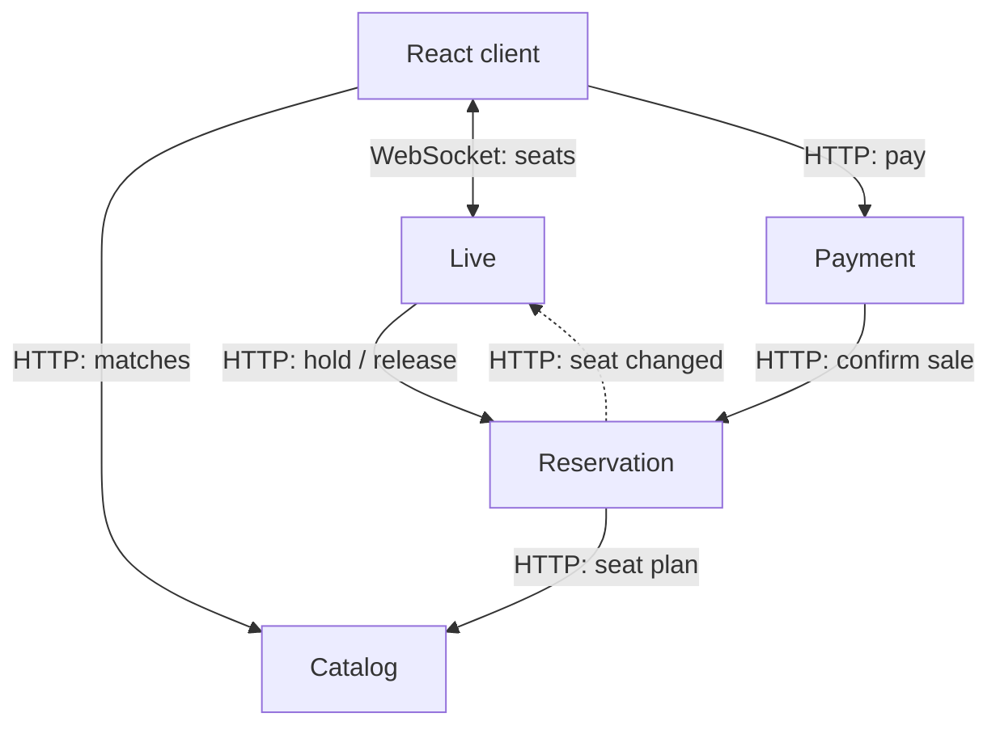

# Match Ticket Booking

Programming 5 course project: four microservices, a web client and live seat updates over
WebSocket.

A user picks a match, opens the stadium seat plan and clicks a seat. The seat is shown as held on
every open screen at once. A hold that is not paid for within two minutes expires and the seat
becomes free again; a successful payment turns it into a sold seat. The project is for anyone who
sells numbered seats and must never sell the same seat twice.

**Current status:** all planned steps are implemented and the system runs locally.

**Full documentation: [`docs/`](docs/README.md)**

## Architecture



Solid arrows are calls where the caller waits for the answer. The dashed arrow is a notification
that is sent without waiting.

| Service | Responsibility | Data it owns |
|---|---|---|
| **Catalog** | Matches, stands and prices | Matches and stands |
| **Reservation** | Holds, releases and expires seats; decides who gets a seat | Seat state |
| **Payment** | Simulated payments | Payments |
| **Live** | WebSocket connections: passes commands on, broadcasts seat changes | Nothing durable |

## Quick start

Requires Node.js 24 or newer.

```bash
npm install
npm run services    # terminal 1: starts the four services
npm run client      # terminal 2, then open http://localhost:5173
```

Open the client in two browser tabs to see seats change live. More in
[Running the project](docs/05-running-the-project.md).

## Results

- Two browser tabs show the same seat plan; a seat held in one tab changes colour in the other
  without a refresh.
- When two users request the same seat, exactly one gets it.
- Holds expire on their own after two minutes.
- A seat can be bought end to end; paying twice for the same hold does not charge twice.
- With the Payment service or the Catalog service stopped, seats can still be held and released.
- After a lost connection the client reconnects and reloads the seat plan on its own.

## Additional Documents

- [Documentation index](docs/README.md)
- [Implementation plan](docs/plan.md)
