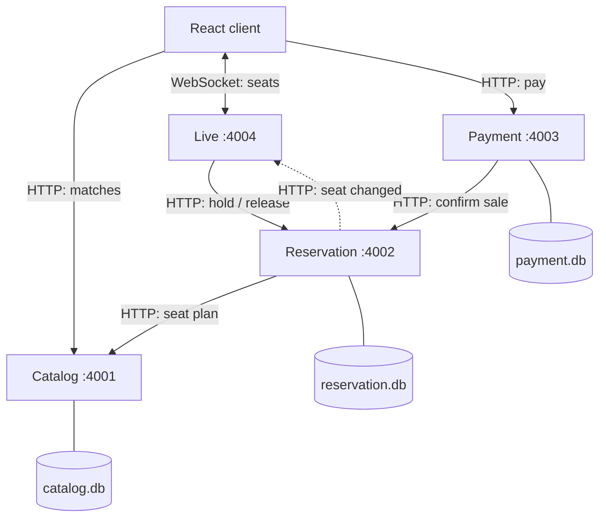

# 2. Architecture

## Figure 1: Containers

Container view: every box is a separately running process or a data store.

Solid arrows are calls where the caller waits for the answer. The dashed arrow is a notification:
Reservation sends it without waiting for the result.

## The four services

| Service | Port | Responsibility | Data it owns |
|---|---|---|---|
| **Catalog** | 4001 | Matches, stands and prices | `catalog.db`: matches, stands |
| **Reservation** | 4002 | Holds, releases and expires seats; decides who gets a seat | `reservation.db`: seat state, plus a read-only copy of the seat plan |
| **Payment** | 4003 | Simulated payments | `payment.db`: payments |
| **Live** | 4004 | WebSocket connections; passes commands on and broadcasts seat changes | Nothing durable: only who is watching which match |

The services are split by business capability: what is on sale, who has which seat, and who paid.
Live is the delivery channel to the browser and contains no business rule; Reservation decides
everything about seats.

## Data ownership

- No service reads or writes another service's database file. A service that needs another
  service's data asks for it over HTTP.
- **The one copy is read-only and may be out of date.** Reservation keeps a copy of the seat plan to
  validate seat ids and prices. It fetches the plan from Catalog the first time a match is used. A
  price changed later in Catalog would not reach the copy; this is acceptable here because the
  catalogue is fixed.
- **The one rule that must always be exact** is "one seat, one owner". It is enforced in one place
  only: the primary key `(match_id, seat_id)` in Reservation's database. When two requests arrive
  for the same seat, the database accepts one and rejects the other.

## Communication rules

| Link | Style | Why |
|---|---|---|
| Client → Catalog | HTTP request-response | The user is waiting for a list to read |
| Client ↔ Live | WebSocket | Both sides send often: the client sends hold and release commands, the server sends every seat change. See below |
| Live → Reservation | HTTP, 2-second time limit | The user who clicked a seat needs a yes or no right away |
| Client → Payment | HTTP request-response | The user is waiting for accepted or declined |
| Payment → Reservation | HTTP, 2-second time limit | Payment must know the price and must be sure the seat is sold before it records the payment |
| Reservation → Catalog | HTTP, 2-second time limit, once per match | The seat plan is needed to validate a seat; afterwards the local copy is used |
| Reservation → Live | HTTP notification, not awaited | The seat is already saved; pushing the change to browsers must not delay or fail the hold |

Every call between services has a time limit, and no request passes through more than two services
while the user waits.

## Why WebSocket

Polling is enough when a delay of a few seconds is acceptable, Server-Sent Events fit immediate
one-way updates, and WebSocket fits immediate two-way traffic. Here the traffic is two-way on
the same screen: every click on a seat is a command from the client, and every other user's click
is an update from the server. A seat plan that is two seconds old makes users click seats that are
already taken, so polling does not fit. Server-Sent Events would work for the updates but would
need a second channel for the commands.

## What happens when something stops

| Stopped | What still works | What the user sees |
|---|---|---|
| Catalog | Holding, releasing and paying for seats on a match page that is already open | The match list and new match pages show "could not be loaded" with a retry button |
| Payment | Browsing, holding and releasing seats, live updates | "The payment service is not responding"; the seats stay held until the timer runs out |
| Reservation | Browsing matches | Seat clicks and payments answer "not responding" within two seconds instead of freezing |
| Live | Browsing matches; seats that are held stay held | "Reconnecting…"; the seat plan is disabled. The client reconnects with a growing delay and reloads the seat plan |

## Repository layout

| Path | Contents |
|---|---|
| `services/catalog/` | Catalog service |
| `services/reservation/` | Reservation service |
| `services/payment/` | Payment service |
| `services/live/` | Live service |
| `client/` | React client |
| `docs/` | This documentation |

No service imports another service's code. Each one is started as its own Node.js process.

Previous: [Overview](01-overview.md) · Next: [Sequence diagrams](03-sequence-diagrams.md)
