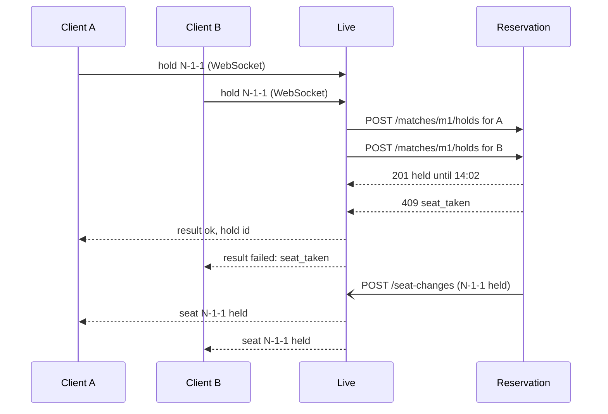
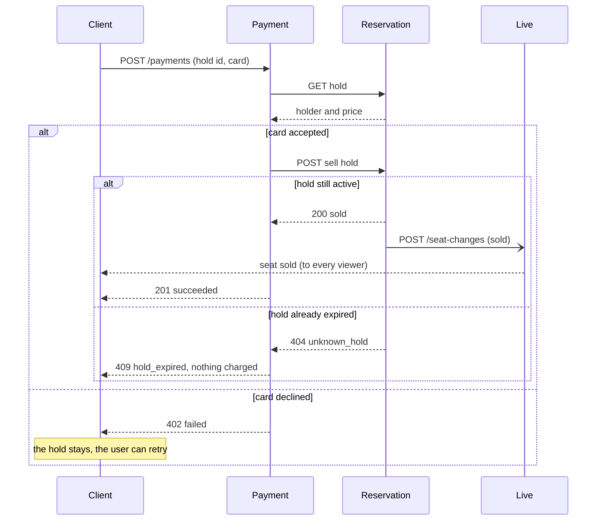
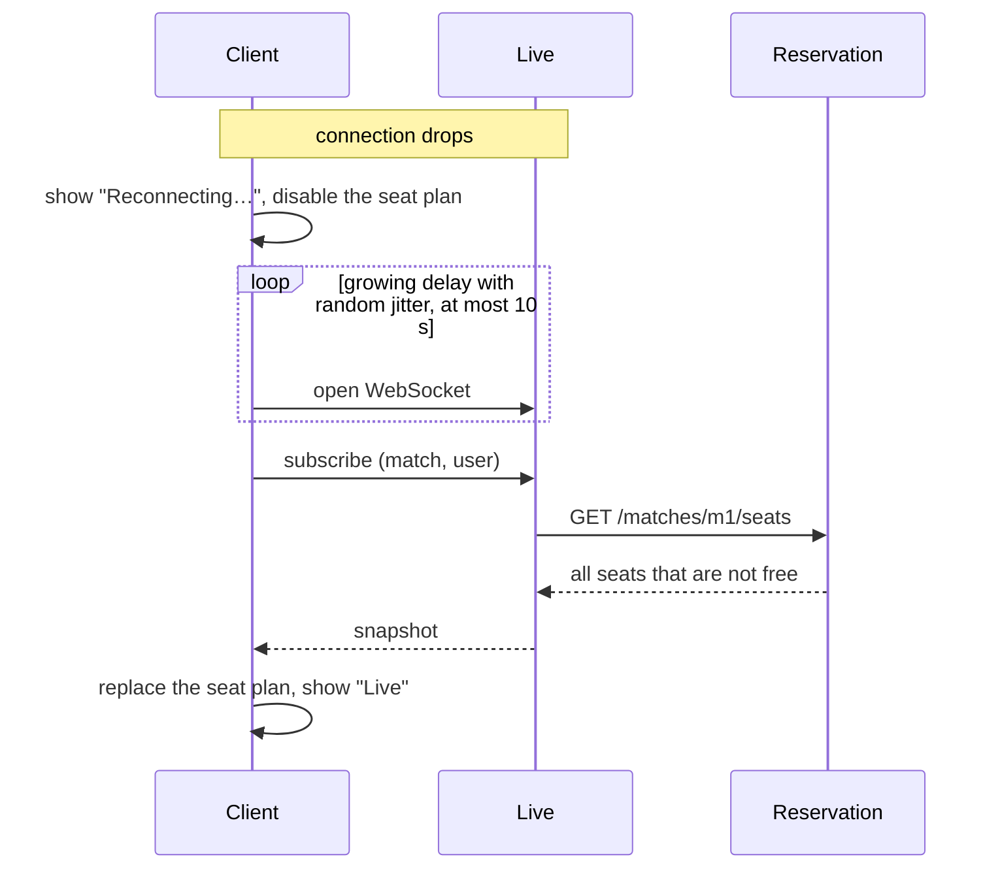
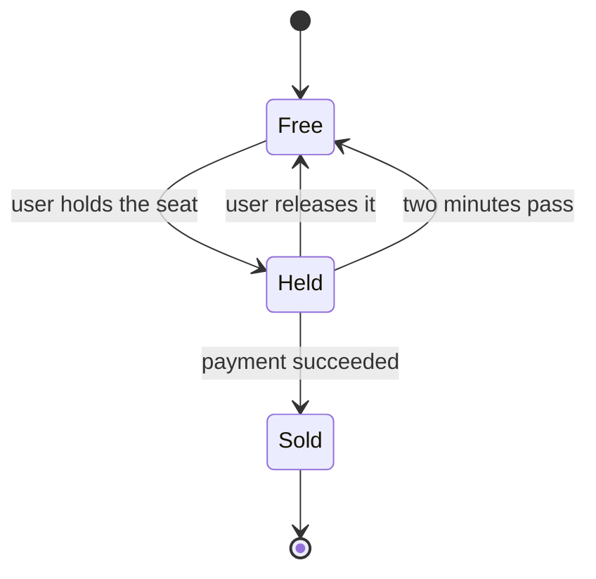

# 3. Sequence and State Diagrams

## Figure 2: Two users click the same seat

Sequence view of one operation: holding a seat.

## Figure 3: Paying for a held seat

The seat is marked as sold before the payment is recorded, so a user never pays for a seat that
went to somebody else. Marking a seat as sold twice changes nothing, which makes a retry after a
timeout safe.

## Figure 4: Connection lost and restored

Reconnecting restores the connection, not the state. The client therefore throws away what it knew
and takes the snapshot as the truth. Its own holds are still there, because they live in
Reservation, not in the connection.

## Figure 5: Lifecycle of a seat

State view of one seat for one match.

A declined payment does not change the state: the seat stays held and the user can try again until
the hold expires.

Previous: [Architecture](02-architecture.md) · Next: [API reference](04-api-reference.md)
